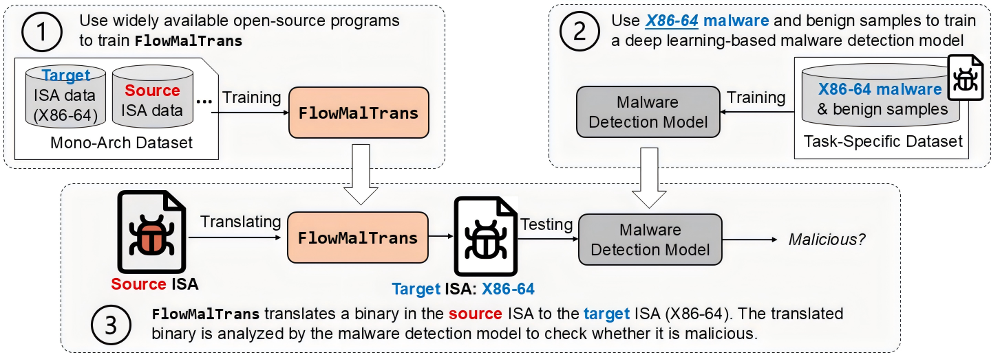

# FlowMalTrans: Unsupervised Binary Code Translation for Malware Detection Using Flow-Adapter Architecture

[](https://arxiv.org/abs/2508.20212)
[](https://arxiv.org/abs/2508.20212)

Official code of **FlowMalTrans** (EMNLP 2025 Findings). [Paper](https://arxiv.org/abs/2508.20212)

Minghao Hu, Junzhe Wang, Weisen Zhao, Qiang Zeng, Lannan Luo — George Mason University

## Overview

Deep-learning malware detectors need many labelled samples *per instruction set architecture (ISA)*, but collecting them
for every ISA (ARM, MIPS, PowerPC, M68K, ...) is slow and expensive. FlowMalTrans avoids this: it learns an
**unsupervised neural translator** from assembly of a source ISA to X86-64, using only **benign, open-source
programs** (no malware, no parallel data). A malware detector is then trained **once on X86-64** and applied unchanged
to the translated code of any other ISA.

The translator is an unsupervised neural machine translation model (denoising auto-encoding + back-translation on top of
CLM / MLM pre-training) extended with a **flow adapter**: a normalizing flow per ISA maps the sentence-level latent code
of one ISA into the latent space of the other, so the target decoder is conditioned on a code that lives in *its own*
ISA's space. In the paper it translates X86-64 ⟷ {i386, ARM32, ARM64, MIPS32, PPC32, M68K} and gives higher BLEU than
UnsuperBinTrans and better detection AUC than UnsuperBinTrans, UniMap, CrossIns2Vec and an IR-based baseline.

<p align="center">
  
</p>
<p align="center">
  <em>Figure 1: Applying FlowMalTrans. (1) Train the translator on benign mono-ISA data, (2) train a malware detector on
  X86-64 malware, (3) translate binaries of another ISA to X86-64 and classify them with the X86-64 detector.</em>
</p>

## Contents

- [Repository layout](#repository-layout)
- [Installation](#installation)
- [Pipeline at a glance](#pipeline-at-a-glance)
- [1. Prepare the data](#1-prepare-the-data)
- [2. Train the translator](#2-train-the-translator)
- [3. Translate](#3-translate)
- [4. Evaluate the translation (BLEU)](#4-evaluate-the-translation-bleu)
- [5. Malware detection](#5-malware-detection)
- [Smoke test](#smoke-test)
- [Results reported in the paper](#results-reported-in-the-paper)
- [Scope, limitations and known gaps](#scope-limitations-and-known-gaps)
- [Responsible use](#responsible-use)
- [Citation](#citation) · [License and acknowledgements](#license-and-acknowledgements)

## Repository layout

```
FlowMalTrans/
├── train.py                 # training entry point (translator; also plain MLM/CLM language models)
├── translate.py             # translation of BPE-encoded assembly (file / folder / stdin)
├── evaluate_bleu.py         # BLEU of translated vs. reference assembly (sacrebleu)
├── preprocess.py            # binarize a BPE text file into the .pth format the trainer reads
├── xlm/                     # the library: Transformer + flows, trainer, evaluator, data loading
│   ├── model/               #   transformer.py (encoder/decoder, latent-code injection), flows.py (scf, glow)
│   ├── trainer.py           #   EncDecTrainer: CLM / MLM / denoising AE / back-translation / flow losses
│   ├── evaluation/          #   perplexity, accuracy, BLEU (multi-bleu.perl) during training
│   └── data/                #   dictionary, datasets, loaders
├── scripts/
│   ├── train_arm32_x86.sh   #   the training recipe of the paper runs, as a command line
│   └── binarize.sh          #   run preprocess.py on every file of a data folder
├── data_prep/
│   ├── format_assembly.py   #   IDA .gdl -> normalized one-basic-block-per-line text (all six ISAs)
│   ├── bpe.sh               #   joint fastBPE learn/apply/vocab for an ISA pair
│   └── legacy_notebooks/    #   the original per-ISA notebooks and helper notebooks (kept for reference)
├── malware_detection/       # LSTM detector: train_lstm.py, test_lstm.py (+ lstm_common.py)
├── analysis/                # exploratory notebooks (dataset statistics, vocabulary overlap, opcode similarity)
├── tests/smoke_test.py      # end-to-end check on synthetic data (see "Smoke test")
└── assets/overview.png
```

Not included in this repository: datasets, trained checkpoints, malware samples (see [Responsible use](#responsible-use)).
`dumped/` (experiment output), `data/` and `output/` are git-ignored.

## Installation

```bash
git clone https://github.com/mhu16419/FlowMalTrans.git
cd FlowMalTrans
python -m venv .venv && source .venv/bin/activate        # Python 3.8+ (developed with 3.10)
pip install -r requirements.txt                          # torch, numpy, sacrebleu (+ scikit-learn, matplotlib, jupyter)
pip install -e .                                         # optional: makes `import xlm` work from anywhere
```

* **A CUDA GPU is required for training** (the training code moves models and batches to the GPU). `translate.py` also
  runs on CPU (`--device cpu`, slow). Multi-GPU / SLURM code paths are inherited from XLM and were not tested; all
  experiments of the paper are single-GPU.
* The code was tested with Python 3.10, **torch 2.3.1 (CUDA 12.1)**, numpy 1.26, sacrebleu 2.6. NVIDIA apex is only
  needed for `--amp >= 0` / `--fp16 true` and is not required otherwise.
* [fastBPE](https://github.com/glample/fastBPE) is needed only for data preparation
  (`g++ -std=c++11 -pthread -O3 fastBPE/main.cc -IfastBPE -o fast`). The assembly disassembly step needs IDA Pro (commercial).
* `perl` is needed if you want BLEU during training (`--eval_bleu true`, uses `xlm/evaluation/multi-bleu.perl`).

## Pipeline at a glance

```
 binaries ──IDA Pro──▶ .gdl ──format_assembly.py──▶ normalized blocks ──bpe.sh──▶ BPE text ──binarize.sh──▶ *.pth
                                                                                                          │
                       train.py  (CLM/MLM pre-training, then DAE + back-translation [+ flow adapter]) ◀───┘
                           │  periodic-<epoch>.pth
                           ▼
 source-ISA BPE files ──translate.py──▶ translated (X86-64) files ──┬──▶ evaluate_bleu.py   (vs. parallel references)
                                                                    └──▶ malware_detection/test_lstm.py  (AUC, X86-64 LSTM)
                                                                                       ▲
                                  x86 benign/malware ──malware_detection/train_lstm.py ┘
```

## 1. Prepare the data

The translator is trained on **monolingual** assembly of the two ISAs (parallel data is only used for validation/test).
In the paper the training corpus consists of openssl-1.1.1p, binutils-2.34, findutils-4.8.0 and libgpg-error-1.45;
the test corpus (zlib-1.2.11, coreutils-9.0, diffutils-3.7) is disjoint. All programs are cross-compiled with GCC at
O0–O3 for each ISA and disassembled with IDA Pro.

**Step 1.1 – export basic-block graphs.** Disassemble every binary with IDA Pro and export the control-flow graph as
`.gdl`, one file per binary. *(There is no script for this step in the repo; IDA is commercial.)*

**Step 1.2 – normalize.** `data_prep/format_assembly.py` turns the `.gdl` files into text with **one basic block per
line**, instructions joined by ` <E> `, applying the normalization rules of the paper (dummy IDA names such as `off_`,
`seg_`, `loc_` → `<OFF>`, `<SEG>`, `<LOC>`, ...; function names → `<FUNC>`; numbers → `<VALUE>` / `<HEX>`):

```bash
python data_prep/format_assembly.py --isa arm32 --input gdl/arm32 --output formatted/arm32
python data_prep/format_assembly.py --selftest          # quick check that all six ISA profiles run
```

Supported `--isa`: `x86`, `i386`, `arm32`, `arm64`, `mips32`, `ppc32`. Useful options: `--func-lists DIR` (function-name
lists for the `<FUNC>` rule), `--cut` (split very long blocks), `--unformatted`, `--jobs N`, `--limit N`;
`--extract-vocab` / `--extract-func-names` build the opcode/register/function lists some ISAs need. The script
reproduces the behaviour of the original notebooks in `data_prep/legacy_notebooks/` (verified on synthetic
`.gdl` input for all six ISAs); it has not been compared against the paper's raw IDA exports, which are not in the repo.

**Step 1.3 – split.** Put the text into one folder per ISA pair with these names (`l1 < l2` alphabetically; the
parallel files must be line-aligned and non-empty):

```
data/raw/arm32-x86/
    train.arm32   valid.arm32   test.arm32          # monolingual, one basic block per line
    train.x86     valid.x86     test.x86
    valid.arm32-x86.arm32   valid.arm32-x86.x86     # parallel blocks of the same source (valid / test only)
    test.arm32-x86.arm32    test.arm32-x86.x86
```

The monolingual `valid`/`test` files are required for every language; the parallel `valid`/`test` pair is required
because back-translation is evaluated on it. Training itself needs **no** parallel data.

**Step 1.4 – BPE.** One *joint* BPE model per ISA pair, so both ISAs share a vocabulary. The number of merge operations
used in the paper (Table 1) is

| ISA pair | merges | | ISA pair | merges |
|---|---:|---|---|---:|
| i386 ⟷ X86-64 | 10,000 | | PPC32 ⟷ X86-64 | 17,000 |
| ARM32 ⟷ X86-64 | 22,000 | | M68K ⟷ X86-64 | 9,000 |
| ARM64 ⟷ X86-64 | 9,000 | | MIPS32 ⟷ X86-64 | 14,000 |

```bash
data_prep/bpe.sh /path/to/fastBPE/fast 22000 arm32 x86 data/raw/arm32-x86 data/processed/arm32-x86
```

This writes the BPE'd files, `codes` and `vocab` (`<token> <count>` per line) into `data/processed/arm32-x86`.

**Step 1.5 – binarize.**

```bash
scripts/binarize.sh data/processed/arm32-x86           # runs preprocess.py on every text file -> <file>.pth
# single file:  python preprocess.py data/processed/arm32-x86/vocab data/processed/arm32-x86/train.arm32
```

`data/processed/arm32-x86` is what you pass to `--data_path`. An existing `.pth` is reused; delete it to re-binarize.
The special tokens `<s>`, `</s>`, `<pad>`, `<unk>`, `<special0..9>` are added in front of the vocabulary.

## 2. Train the translator

`train.py` is a single entry point. The paper recipe is in [`scripts/train_arm32_x86.sh`](scripts/train_arm32_x86.sh):

```bash
bash scripts/train_arm32_x86.sh          # DATA=data/processed/arm32-x86 DUMP=dumped (override via env vars)
```

which is equivalent to

```bash
python train.py --exp_name arm32-x86 --dump_path dumped \
    --data_path data/processed/arm32-x86 --lgs arm32-x86 \
    --encoder_only false --separate_decoders true --use_latent_code false \
    --emb_dim 64 --n_layers 4 --n_heads 4 --dropout 0.1 --attention_dropout 0.1 \
    --ae_steps arm32,x86 --clm_steps arm32,x86 --mlm_steps arm32,x86 \
    --bt_steps arm32-x86-arm32,x86-arm32-x86 \
    --word_shuffle 3 --word_dropout 0.1 --word_blank 0.1 \
    --two_stage true --bt_begin_epoch 2000 --eval_periodic 20 --eval_every 0 \
    --epoch_size 4000 --accumulate_gradients 8 --max_epoch 10000 \
    --batch_size 300 --tokens_per_batch 2000 --max_len 200 \
    --optimizer "adam_inverse_sqrt,beta1=0.9,beta2=0.98,lr=0.0003" \
    --save_periodic 200 --debug_slurm true
```

**What it does.** One shared Transformer encoder (with an ISA embedding) and one decoder per ISA
(`--separate_decoders true`; the first language of `--lgs` owns `src_decoder`, the second `tgt_decoder`).

* *Stage 1, epochs `< --bt_begin_epoch`*: causal LM (CLM), masked LM (MLM) and denoising auto-encoding (AE, with word
  shuffle / dropout / blank noise) on both ISAs.
* *Stage 2, epochs `>= --bt_begin_epoch`*: back-translation (BT) only, in both directions
  (`arm32→x86→arm32`, `x86→arm32→x86`). This is `--two_stage true`; without it the stage-1 steps keep running and BT is
  added on top (the default behaviour).
* `--eval_periodic N` runs one **extra BT step** every N epochs (epoch 0 included). Despite its historical name it is a
  *training* step, not an evaluation. `0` disables it.
* `--eval_every N` runs the validation/test evaluation (perplexity, accuracy, and BLEU with `--eval_bleu true`) every N
  epochs and keeps the best model; `0` (as in the recipe) skips it, `1` evaluates every epoch.
  Note that the CLM/MLM evaluations stream the whole valid/test sets, so evaluating every epoch is slow for long epochs.
* One *epoch* is `epoch_size × accumulate_gradients` sentences counted in `--batch_size` units, not a pass over the data.

**Settings of the finished runs.** The values above are those recorded in the `params.pkl` of our arm32→x86 run. The
other ISA pairs used the same recipe with these differences: learning rate 3e-4 (arm32 and the two IR pairs),
5e-4 (i386, mips32) or 1e-3 (arm64, ppc32, s390x); `--max_len` 200 (arm32, arm64, ppc32) or 300 (i386, mips32, s390x);
`--batch_size` 64–360. The parameter study used `--emb_dim 32 / 64 / 128`.

**Output** goes to `dumped/<exp_name>/<exp_id>/` (`<exp_id>` is random unless `--exp_id` is given):
`params.pkl` and `train.log` (every parameter and loss), `periodic-<epoch>.pth` every `--save_periodic` epochs
(encoder, `src_decoder`, `tgt_decoder`, optimizer state, vocabulary, parameters), and `hypotheses/` with the reference
files used for BLEU. Add `--save_last_checkpoint true` to also keep `checkpoint.pth`, which is resumed automatically
when you restart with the same `--exp_id`.

**Resume / reload.** `--reload_checkpoint dumped/arm32-x86/<exp_id>/periodic-<epoch>.pth` restores weights, epoch,
iteration counter and learning-rate step (Adam moments are *not* restored; `--is_checkpoint false` loads weights only).

**Flow adapter and latent code.** Enable them with

```
--use_latent_code true --flow_type scf        # or glow;  --z_size 256 --hiddenflow_flow_nums 3 --hiddenflow_layers 3
```

The sentence code `z` is computed from the encoder output by mean-pooling, max-pooling and the first token
(`--use_mean_pooling`, `--use_max_pooling`, `--use_CSL`; concatenated or summed, `--concat_h`) and, if needed, projected to
`--z_size`. One flow per ISA (`src_flow`, `tgt_flow`) is trained with a density loss (`--nll_weight`); in a
back-translation step the code is mapped `src_flow → Gaussian → tgt_flow` and fed to the other decoder, where it is
injected before the output projection (`--latent_concat`, `--use_weight_network`; `--detach_type`,
`--consider_nll_in_bt` control gradients). The flow code path was exercised end to end on small synthetic runs (train, evaluate, resume; translation with
latent codes was tested on randomly initialised models), but the values of `z_size`, pooling and loss weights used for the paper's flow experiments are not recorded in this
repository; the defaults above are the code defaults, not a verified reproduction of the paper's best configuration.

**Other notes**

* `--encoder_only` defaults to `true` (a plain language model, as in XLM). Translation needs `--encoder_only false`.
* The *order* of `--lgs` matters (`arm32-x86` ⇒ `src_decoder` generates arm32, `tgt_decoder` generates x86); `translate.py`
  reads it from the checkpoint.
* `--seed` seeds python/numpy/torch but runs are still not bit-exact (the AE/BT batch order uses an unseeded generator).
* `python train.py --help` lists every option, including the XLM options (memory, adaptive softmax, multi-GPU) that the
  paper does not use.
* Plain language-model pre-training (as used for the IR baselines) is the same script with
  `--encoder_only true --clm_steps X --mlm_steps X --lgs X`.

## 3. Translate

```bash
python translate.py --model_path dumped/arm32-x86/<exp_id>/periodic-9400.pth --info        # what is in the checkpoint?

# a folder of BPE-encoded files (one file per binary) -> same file names in the output folder
python translate.py --model_path dumped/arm32-x86/<exp_id>/periodic-9400.pth \
    --src_lang arm32 --tgt_lang x86 \
    --src_folder data/detection/arm32/benign --output_folder output/arm32_translation/arm32_benign \
    --batch_size 200 --max_len 200

# a single file, or stdin -> stdout
python translate.py --model_path ... --src_lang arm32 --tgt_lang x86 --src_path in.bpe --output_path out.bpe
cat in.bpe | python translate.py --model_path ... --src_lang arm32 --tgt_lang x86 > out.bpe
```

* Input must be BPE-segmented with the **same codes and vocabulary as training**, one basic block per line.
* The right decoder is chosen from `--tgt_lang` and the `--lgs` order stored in the checkpoint; both directions work.
* Lines longer than `--max_len` are dropped by default (`--long_lines drop`); use `--long_lines empty` to keep the output
  line-aligned with the input (needed for BLEU) or `truncate`. Source files are never deleted; existing outputs are skipped
  (`--overwrite` to replace them). Decoding is greedy (`--beam_size 1`) as in the paper; batches are length-sorted for speed.
* Output: one line per translated basic block, X86-64 tokens in the model vocabulary with `<E>` between instructions.
* Checkpoints are Python pickles: only load checkpoints you trust.

## 4. Evaluate the translation (BLEU)

The paper compiles the same program for the source ISA and for X86-64, translates the source binary and reports the
BLEU between the translated binary and the X86-64 binary, averaged over binaries (SacreBLEU, tokenization `none`,
add-one smoothing). `evaluate_bleu.py` computes exactly that for parallel test files that have the same names and are
line-aligned (translate with `--long_lines empty`); scores are on the paper's 0–1 scale:

```bash
python evaluate_bleu.py --hyp_folder output/arm32_translation/arm32_benign --ref_folder data/parallel_test/x86
python evaluate_bleu.py --hyp_path out.bpe --ref_path ref.bpe
```

Files whose line counts differ are reported and skipped (`--mismatch truncate|error` changes this; `--per_file` prints
each file). The script replaces `BLEU_Evaluation.ipynb`, which fed strings instead of token lists to its n-gram code and
therefore computed a character-overlap score (see the git history).

## 5. Malware detection

The detector is a small LSTM (embedding lookup → LSTM → max-pool over time → linear, `BCEWithLogitsLoss`, Adam). It has
no vocabulary of its own: tokens are mapped to the **frozen token embeddings of the translation checkpoint** (`dico_word2id`
and `encoder.embeddings.weight`). Consequently a detector is tied to the translation checkpoint it was trained with — train
and test with the same `--translation-ckpt`.

```bash
# 1. train on X86-64 benign / malware token files (BPE-segmented, one file per binary)
python malware_detection/train_lstm.py \
    --benign-dir data/detection/x86/benign --malware-dir data/detection/x86/malware \
    --translation-ckpt dumped/arm32-x86/<exp_id>/periodic-9400.pth \
    --out-dir detector/arm32 --hidden 16 --layers 2 --batch-size 24 --epochs 4 --test-size 0.4

# 2. score the TRANSLATED source-ISA files with the X86-64 detector -> AUC, ROC curve, per-file predictions
python malware_detection/test_lstm.py \
    --benign-dir output/arm32_translation/arm32_benign --malware-dir output/arm32_translation/arm32_malware \
    --translation-ckpt dumped/arm32-x86/<exp_id>/periodic-9400.pth \
    --lstm-weights detector/arm32/lstm_it3.pt --out-prefix results/arm32
```

`train_lstm.py` writes `lstm_it<epoch>.pt` after every epoch, `train_log.json` and `split.json` (the train/held-out file
lists); `test_lstm.py` writes `<prefix>_predictions.txt`, `<prefix>_roc.png` and `<prefix>_metrics.json` (AUC, number of
files, OOV ratio). Hidden size and layer count are read from the weight file. The same script scores native X86-64
files (the "same-ISA" setting). Details such as the length threshold (70th percentile of the token counts, truncate /
zero-pad, padding is not masked) follow the original notebooks; see `--help` of both scripts.

The hyper-parameters in the example are those of the original ISA notebooks (2 LSTM layers, 16 hidden units). Table 6 of
the paper lists 3 layers and batch size 36; `--layers` and `--batch-size` let you choose either. No CNN detector (reported
in the appendix of the paper) is included.

## Smoke test

`tests/smoke_test.py` runs the whole pipeline (binarize → train for a few epochs with separate decoders → translate →
BLEU → LSTM train/test) on a tiny synthetic corpus and checks that every stage produces its outputs. It needs a CUDA GPU and
takes a few minutes:

```bash
python tests/smoke_test.py --workdir /tmp/flowmaltrans_smoke
```

## Results reported in the paper

Numbers below are copied from the paper (X86-64 is always the target ISA; the paper's tables are authoritative).

**Translation quality (BLEU, Table 2)**

| Source ISA | FlowMalTrans | UnsuperBinTrans |
|---|---:|---:|
| i386 | 0.41 | 0.35 |
| ARM32 | 0.40 | 0.28 |
| ARM64 | 0.37 | 0.32 |
| MIPS32 | 0.36 | 0.27 |
| PPC32 | 0.31 | 0.25 |
| M68K | 0.39 | 0.31 |

**Malware detection (LSTM, AUC, Table 3)** — X86-64 detector applied to translated code

| Source ISA | FlowMalTrans | UnsuperBinTrans | UniMap | CrossIns2Vec | IR-based | Same-ISA detector |
|---|---:|---:|---:|---:|---:|---:|
| i386 | **0.996** | 0.723 | 0.953 | – | 0.819 | 0.998 |
| ARM32 | **0.981** | 0.818 | 0.953 | 0.976 | 0.815 | 0.986 |
| ARM64 | **0.965** | 0.638 | 0.910 | – | 0.825 | 0.705 |
| MIPS32 | **0.971** | 0.725 | 0.933 | 0.964 | 0.791 | 0.974 |
| PPC32 | **0.973** | 0.722 | 0.919 | 0.967 | 0.639 | 0.849 |
| M68K | **0.931** | 0.689 | 0.893 | – | 0.476 | 0.790 |

Ablations of the paper (LSTM AUC): the 3-layer `scf` flow is best (e.g. i386 0.996 vs. 0.854 without the flow adapter);
`glow` and 5-layer flows are worse; removing any normalization rule hurts strongly (for example ARM32: 0.981 with all
rules, 0.521 without `<OFF>`/`<SEG>`, 0.575 without `<FUNC>`, 0.533 without `<VALUE>`/`<HEX>`); embedding size 64 is
better than 32 and 128. Training one translator takes about 22–25 hours on one RTX 4090.

Basic blocks used for translator training (paper, appendix A.3): X86-64 2,789,119 · i386 2,803,557 · ARM64 7,413,083 ·
ARM32 5,812,795 · MIPS32 4,813,685 · PPC32 3,964,237 · M68K 5,463,395. Malware (VirusShare) used for the detectors:
X86-64 2,140 · i386 1,740 · ARM32 1,581 · MIPS32 1,430 · PPC32 962 · M68K 545 · ARM64 128.

## Scope, limitations and known gaps

Scope of the method (from the paper): Linux (ELF) malware only, unpacked and not obfuscated; translation is
X86-64 ⟷ {i386, ARM32, ARM64, MIPS32, PPC32, M68K}, not any-to-any; using ARM32 as a *target* is future work.

Things this repository does **not** provide:

* The binary → `.gdl` export (needs IDA Pro) and the compilation of the benign corpora.
* A tool that aligns basic blocks between two ISAs to build the parallel valid/test sets, and the train/valid/test
  split used in the paper. `data_prep/legacy_notebooks/find_parallel_blocks.ipynb` only pairs files of the same program.
* Formatting profiles for M68K and S390x (the paper uses M68K; the six profiles in `format_assembly.py` are the ones that
  have notebooks). The `x86`, `i386`, `arm32` and `arm64` profiles are those of the original notebooks, which do not emit
  every special token of the paper's final normalization (for example `<ADDR>`).
* Datasets, trained checkpoints, a CNN detector and the figure of the model architecture.
* Tested multi-GPU / SLURM training. Use a single GPU.

Verified in this repository (torch 2.3.1, one GPU): all stages of the [smoke test](#smoke-test); loading and translating with
checkpoints of earlier runs (separate-decoder, no-flow configuration); the unified scripts against the behaviour of the
original notebooks they replace (data formatting and the LSTM scripts on synthetic data, training schedule step counts,
translation output). Not verified: bit-exact reproduction of the paper's numbers.

## Responsible use

Following the paper's ethics statement, **no malware binaries are distributed with this work**. Only cryptographic hash
identifiers of VirusShare samples may be shared so that qualified researchers can obtain the samples themselves from
[VirusShare](https://virusshare.com). The folders `Malware_detection_code/` and `Malware_detection_files/` that some local
experiments use are git-ignored on purpose; never commit tensors, translated files or models derived from malware samples.
The method targets *defensive* malware detection; do not use it to build or evade-test malware.

## Citation

If you find our work useful, please cite:

```bibtex
@inproceedings{hu2025unsupervised,
  title     = {{FlowMalTrans}: Unsupervised Binary Code Translation for Malware Detection Using Flow-Adapter Architecture},
  author    = {Minghao Hu and Junzhe Wang and Weisen Zhao and Qiang Zeng and Lannan Luo},
  booktitle = {Findings of the Association for Computational Linguistics: EMNLP 2025},
  year      = {2025},
  eprint    = {2508.20212},
  archivePrefix = {arXiv},
  url       = {https://openreview.net/forum?id=hfl5oqbfj1}
}
```

## License and acknowledgements

The code is released under the license in [LICENSE](LICENSE). The training, model and data-loading code under `xlm/`,
`train.py`, `translate.py` and `preprocess.py` is derived from Facebook AI Research's
[XLM](https://github.com/facebookresearch/XLM) (Lample & Conneau, *Cross-lingual Language Model Pretraining*, 2019); those
files keep their original copyright headers and remain subject to the upstream license terms. The flow implementations are
based on the normalizing-flow code of Karpathy's [pytorch-normalizing-flows](https://github.com/karpathy/pytorch-normalizing-flows)
(`scf` = scaling and coupling flow, RealNVP-style). This work was supported by NSF grant CNS-2304720 and the Commonwealth
Cyber Initiative.
